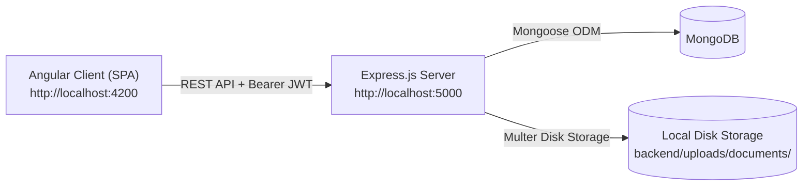

# UEM Admission System

An end-to-end University Admission Management Portal developed using the **MEAN Stack** (MongoDB, Express.js, Angular, Node.js). Designed for a university Software Engineering Lab submission, the platform automates candidate registration, multi-step application drafting, mandatory document uploads, document-type-aware verification, and administrative selection decisions.

---

## 1. Project Overview

The UEM Admission System digitizes the academic admission workflow for undergraduate and postgraduate programmes. It replaces manual paper-based admissions with a structured, role-segregated digital pipeline. The system enforces strict stage transitions, prevents premature draft processing, provides live status tracking with document replacement capabilities, and delivers role-based dashboards for staff.

---

## 2. Key Features

- **Applicant Registration & Auto-Profile**: Self-service registration with bcrypt password hashing, immediate session generation, and auto-populated application profiles.
- **Two-Step Application & Draft Lifecycle**: Step 1 captures personal and academic details, generating an Application ID (`UEM-YYYY-XXXXXX`) in `Draft` status. Draft applications are strictly excluded from staff verification queues and administrative metrics.
- **Document Upload Center**: Step 2 requires mandatory document uploads (`Class 10 Marksheet`, `Class 12 Marksheet`, and `Identity Proof`) with validation for file types and file sizes before enabling final submission.
- **Document-Type-Aware Verification**: Verification Officers review active documents individually, approve or reject them with mandatory remarks, and track replacement chains. Superseded files are preserved in a collapsible archive.
- **Candidate Status & In-Place Document Replacement**: Real-time status tracking (`Submitted`, `Under Review`, `Verified`, `Selected`, `Rejected`) with the ability to upload replacement files for rejected documents directly from `/status`.
- **Administrative Management Dashboard**: Administrators view aggregated admission metrics by programme and status, filter/search applicants, inspect dossiers, and record final admission decisions (`Selected` or `Rejected`).
- **Strict Role-Based Access Control**: Server-side JWT authorization ensures strict isolation between applicant and staff endpoints. Sign-out from any portal reliably clears session state and redirects to the public Home page (`/`).

---

## 3. Technology Stack

- **Frontend**: Angular 22 (Standalone Components, Signals, Reactive Forms, Router, HTTP Client), SCSS
- **Backend**: Node.js, Express.js 5, Multer (multipart file upload), JSON Web Token (JWT), Bcrypt, Dotenv, CORS
- **Database**: MongoDB (via Mongoose 9 ODM)
- **Testing**: Node.js Test Runner (`node --test`), Vitest (Angular unit tests)

---

## 4. Architecture



1. **Client Tier**: Angular SPA manages presentation, reactive state signals, route guards (`authGuard`, `adminGuard`, `verificationGuard`), and bearer-token HTTP interceptors.
2. **Server Tier**: Express REST API handles authentication, enforces server-side role authorization (`authenticate`, `authorize`), validates input payloads, and processes file uploads.
3. **Data Tier**: MongoDB stores collections for `users`, `applications`, and `documents`, utilizing unique indexes and aggregation pipelines (`$match`, `$group`) for metrics.
4. **Document Storage**: Physical documents are stored on the local filesystem under `backend/uploads/documents/` using sanitized, timestamped filenames (`doc-<timestamp>-<hash>.<ext>`), while metadata and verification states reside in MongoDB.

---

## 5. User Roles

| Role | Portal / Routes | Permissions & Responsibilities |
| :--- | :--- | :--- |
| **Applicant** | `/login`<br>`/application`<br>`/status` | Registers, creates/edits draft applications, uploads mandatory documents, performs final submission, monitors review status, and uploads replacement files for rejected documents. |
| **Verification Officer** | `/staff-login/verification`<br>`/verification` | Inspects submitted applications, marks applications `Under Review`, verifies or rejects individual documents with remarks, and marks applications as `Verified`. Cannot reject an entire application. |
| **Administrator** | `/staff-login/admin`<br>`/admin` | Views real-time admission statistics, searches/filters applications, reviews complete application dossiers and historical archives, and makes final admission decisions (`Selected` or `Rejected`). |

---

## 6. Setup and Execution

### Prerequisites
- **Node.js**: v18.x or later
- **npm**: v9.x or later
- **MongoDB**: Local Community Server (`mongodb://localhost:27017`) or MongoDB Atlas URI

### 1. Environment Configuration
In the `backend/` directory, configure `.env` (a template is provided in `backend/.env.example`):
```env
PORT=5000
MONGODB_URI=mongodb://localhost:27017/uem_admission
JWT_SECRET=your_secure_jwt_secret_key_here
```
*(Note: `.env` is git-ignored and must never contain production secrets in version control).*

### 2. Dependency Installation
```bash
# Install backend dependencies
cd backend
npm install

# Install frontend dependencies
cd ../frontend
npm install
```

### 3. Staff Account Provisioning (Optional)
Provision initial administrator and verification officer accounts using the bundled CLI script:
```bash
cd backend
node scripts/provision-staff.js --name="Admin User" --email="admin@uem.edu.in" --password="AdminPassword123" --role="admin"
node scripts/provision-staff.js --name="Officer User" --email="officer@uem.edu.in" --password="OfficerPassword123" --role="verification_officer"
```

### 4. Running the Servers
Open two terminal windows to run both layers concurrently:
```bash
# Terminal 1: Backend Server (runs on http://localhost:5000)
cd backend
npm start

# Terminal 2: Frontend Server (runs on http://localhost:4200)
cd frontend
npm start
```

---

## 7. Testing

All test suites and build scripts have been validated:

```bash
# 1. Run Backend Tests (Node.js test runner)
npm --prefix backend test
# Result: 68/68 passed (auth, RBAC, draft exclusion, document replacement chain)

# 2. Run Frontend Tests (Vitest)
npm --prefix frontend test -- --no-watch
# Result: 202/202 passed across 19 test suites

# 3. Production Build
npm --prefix frontend run build
# Compiles optimized bundles to frontend/dist/frontend
```

---

## 8. Security and Limitations

### Security Measures
- **Password Security**: Passwords salted and hashed with bcrypt (10 rounds); password hashes are strictly stripped from all JSON responses.
- **JWT Authentication & RBAC**: Stateless signed JWT tokens validated on every protected endpoint. Route guards block unauthorized UI navigation, and server-side middleware prevents API privilege escalation.
- **File Upload Protection**: Whitelisted MIME types (`PDF`, `JPEG`, `PNG`, `WebP`), file extension cross-checks, 10 MB file size limit, and randomized server-side filenames to prevent file injection and path traversal.
- **Session Termination**: Sign-out from any portal purges cached authentication tokens from browser storage and redirects to `/`.

### Limitations
- **Local Disk Storage**: Uploaded files are stored on the server's local disk (`backend/uploads/documents/`). In a production cloud deployment, this should be backed by an object storage service (e.g., AWS S3 or Google Cloud Storage).
- **Client Storage**: Tokens are stored in browser `localStorage`. A production deployment could enhance this using `httpOnly` secure cookies with CSRF token validation.
